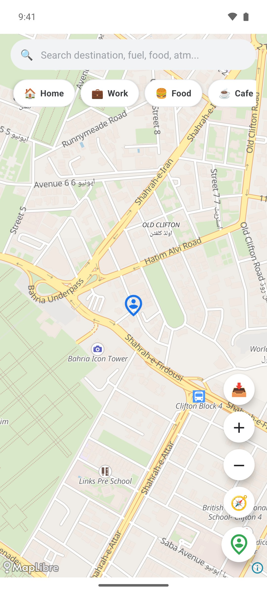
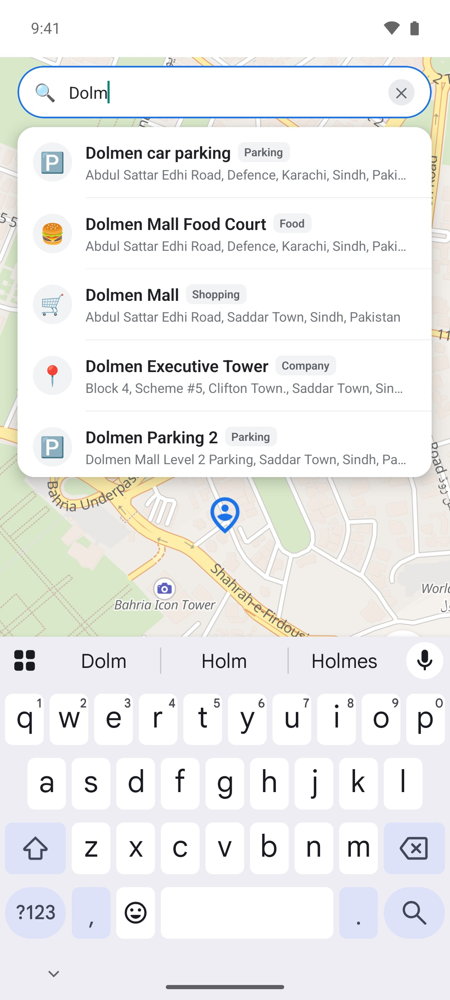
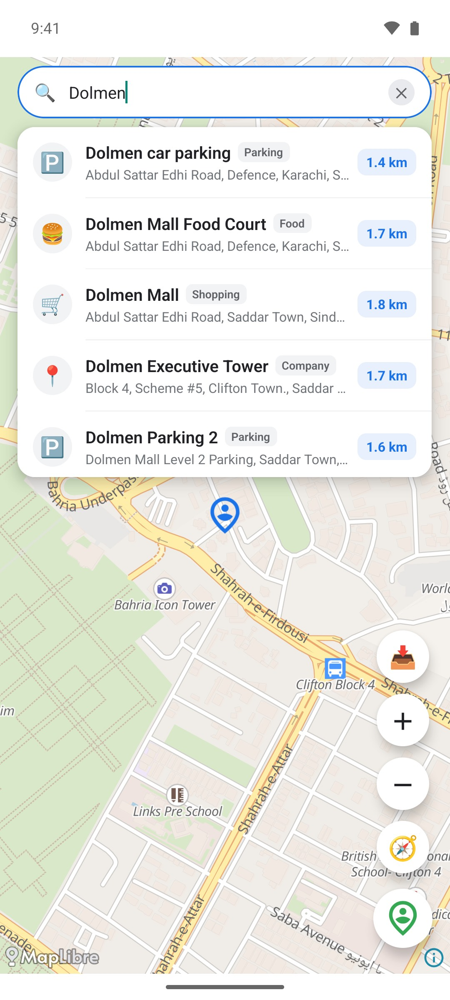
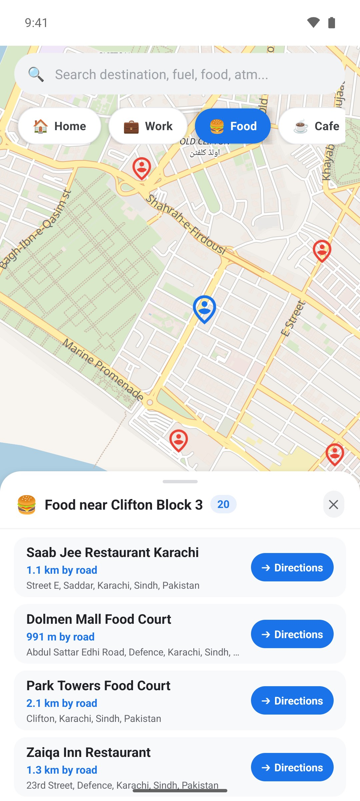
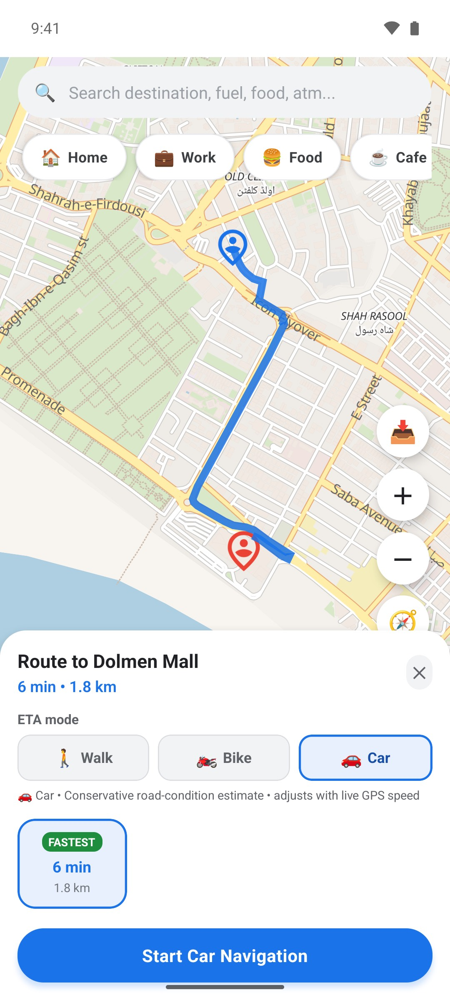
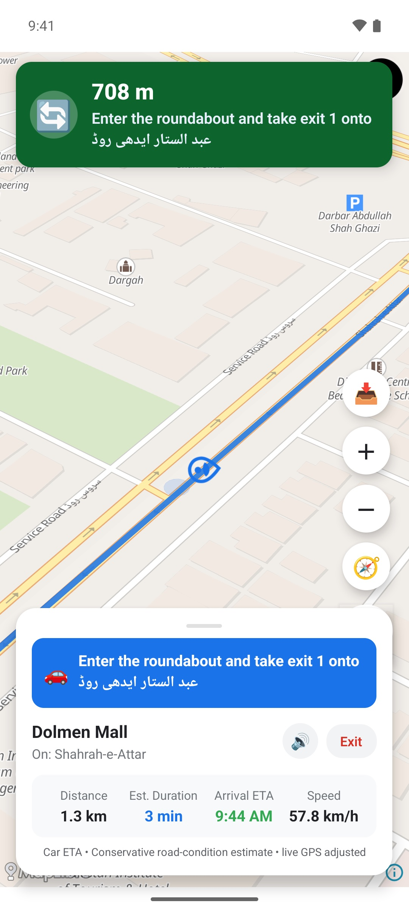
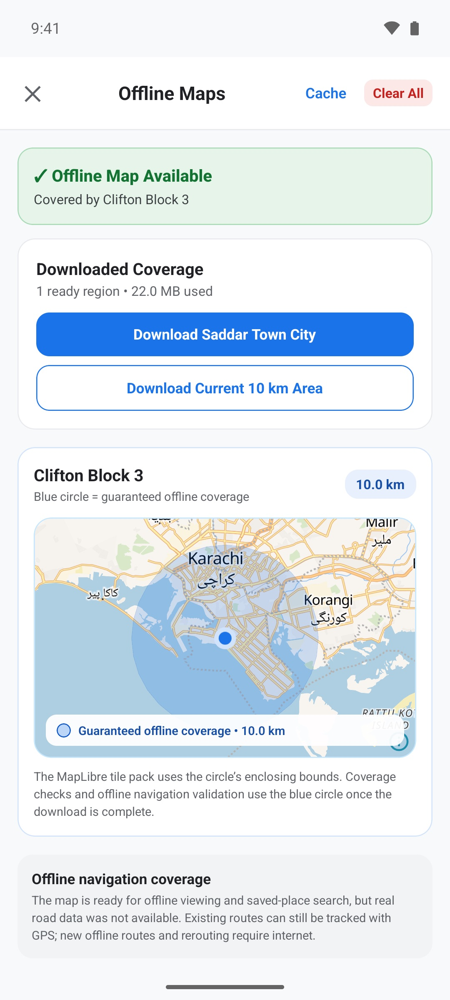

# NaviGo

Turn-by-turn navigation for Android, built with React Native and TypeScript
on open map data only: MapLibre vector maps, OpenStreetMap search, OSRM
routing and offline map packs. No Google Maps or Mapbox API keys are needed.

<table>
  <tr>
    <td align="center"><br><sub>Live location on the map</sub></td>
    <td align="center"><br><sub>Instant place search</sub></td>
    <td align="center"><br><sub>Results with road distances</sub></td>
    <td align="center"><br><sub>Nearby places by category</sub></td>
  </tr>
  <tr>
    <td align="center"><br><sub>Route preview with ETA</sub></td>
    <td align="center"><br><sub>Turn-by-turn live navigation</sub></td>
    <td align="center"><br><sub>Offline map downloads</sub></td>
    <td></td>
  </tr>
</table>

<sub>Screenshots: Android release build on an emulator with a simulated GPS
location in Clifton, Karachi.</sub>

## Features

- Live GPS location with an accuracy circle and a follow / recenter camera
- Place search with autocomplete from the first character, limited to 25 km
  around you, with driving distance for every result
- One-tap nearby search across 11 categories (food, cafe, ATM, fuel,
  hospital, pharmacy, parking and more)
- Route preview with up to 3 OSRM alternatives and walk / bike / car ETA
- Turn-by-turn navigation: 3D follow camera, next-turn card, remaining
  distance, arrival time, live speed and native voice prompts
- Automatic rerouting once you have clearly left the route
- Offline map downloads for a 10 km area or a named city
- Saved Home / Work places and recent searches

## Try it

NaviGo runs on Android (minSdk 24). An installable APK will be published on
the [Releases](https://github.com/Awais-Chandio/NaviGo/releases) page; until
then, build it from source with the steps under [Setup](#setup). Allow
precise location when the app asks; search, nearby places and routing all
start from your live GPS position.

## Tech stack

React Native 0.86 (CLI) · React 19 · TypeScript · MapLibre React Native 11 ·
OpenFreeMap tiles · OSRM · Photon · Nominatim · Overpass API ·
react-native-geolocation-service · react-native-permissions ·
react-native-tts · AsyncStorage · Jest · GitHub Actions

## Architecture

- `src/screens`: screen composition and map UI
- `src/hooks`: location, navigation, and saved-place orchestration
- `src/services`: domain state, persistence, GPS, navigation, and offline packs
- `src/repositories`: Photon, Overpass, and OSRM transport/parsing
- `src/utils`: geodesic, route-progress, ranking, logging, and network helpers

The app currently uses foreground location only. Downloaded MapLibre regions
provide offline rendering for their exact style and zoom range. Offline search
and offline road-graph routing are not installed; the app deliberately refuses
to fabricate straight-line driving routes.

## Setup

Requirements:

- Node.js 22.11 or newer
- Android SDK/API 36 and a compatible JDK
- Xcode and CocoaPods for iOS

Install JavaScript dependencies:

```sh
npm ci
```

Install iOS pods after dependency or Podfile changes:

```sh
cd ios
bundle exec pod install
cd ..
```

Run the app:

```sh
npm start
npm run android
# or
npm run ios
```

## Verification

```sh
npm run verify
npm run android:lint
cd android && ./gradlew app:assembleDebug
```

Release builds require Android signing properties named
`NAVIGO_UPLOAD_STORE_FILE`, `NAVIGO_UPLOAD_STORE_PASSWORD`,
`NAVIGO_UPLOAD_KEY_ALIAS`, and `NAVIGO_UPLOAD_KEY_PASSWORD`. Release tasks fail
closed when any property is missing; they never fall back to the debug key.
Use `npm run build:aab` for the Play Store artifact after configuring them.

Before a store submission, complete [docs/RELEASE_CHECKLIST.md](docs/RELEASE_CHECKLIST.md)
and replace every bracketed field in [docs/PRIVACY_POLICY.md](docs/PRIVACY_POLICY.md).

## External services

- Photon: autocomplete and reverse geocoding
- Overpass API: nearby POIs
- OSRM: online driving routes and alternatives
- OpenFreeMap: MapLibre vector-map styles and tiles

The checked-in endpoints are public community services, not contractual
production SLAs. A public release with sustained traffic should use
organization-controlled or contracted endpoints, monitoring, quotas, and an
appropriate privacy policy. Requests include timeouts, cancellation, bounded
in-memory caching, response validation, and conservative retries.

Map attribution remains enabled through MapLibre. OpenStreetMap-derived data
must retain the attribution required by its data providers.

## Location and offline behavior

- Android requires precise/fine foreground location.
- iOS includes only the `LocationWhenInUse` permission handler.
- GPS fixes over the configured accuracy threshold are rejected.
- Offline regions store a name, center, radius, covered area, download date,
  version, size, and status in a cached metadata index.
- The Offline Maps screen visualizes the guaranteed circular coverage area and
  reports whether the current GPS fix is inside a completed region.
- The native MapLibre pack downloads the circle's enclosing tile bounds; the
  same center and radius drive its metadata, UI, map boundary, duplicate
  detection, and navigation coverage checks.
- Active offline map packs are reconciled and observed after relaunch without
  repeatedly scanning map files.
- A map pack stores render resources; it is not a routable road graph.

For genuine offline routing, ship a versioned regional road graph and integrate
a real offline routing engine before enabling that feature in the UI.
